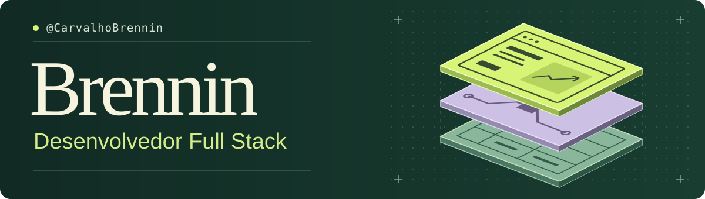
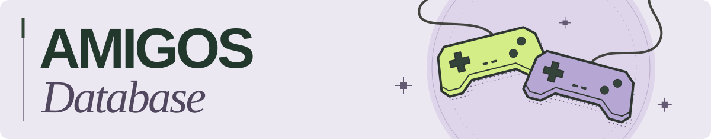

<h1>
  
</h1>

Na **OKTA7**, desenvolvo as telas que as equipes usam no dia a dia e os serviços por trás delas. Trabalho com **React e TypeScript** na interface, **ASP.NET Core** nas APIs e **SQL Server e PostgreSQL** na camada de dados.

[LinkedIn](https://www.linkedin.com/in/brennocarvalho) · [Repositórios](https://github.com/CarvalhoBrennin?tab=repositories) · [Experiência](#experiência)

## Projeto em destaque

  

**O que vamos jogar juntos?** O AMIGOS Database é o catálogo que mantenho para quem procura jogos cooperativos ou de navegador. Dá para filtrar os títulos, abrir a ficha de cada jogo e consultar preços em reais pela integração com a CheapShark.

A interface tem seis idiomas. Uso **Vitest** nos testes unitários e **Playwright** para testar os fluxos de navegação de ponta a ponta.

[Explorar o código do AMIGOS Database →](https://github.com/CarvalhoBrennin/amigos-database)

## Experiência

### Desenvolvedor Full Stack · OKTA7

*Set. 2025 – atual · Alphaville, SP*

Desenvolvo interfaces responsivas e APIs em ASP.NET Core para uma plataforma corporativa com requisitos regulatórios. Também cuido das integrações entre sistemas, da modelagem de dados e das consultas que alimentam as telas.

### Analista de Infraestrutura Júnior · OKTA7

*Ago. 2025 – set. 2025 · Alphaville, SP*

Preparei máquinas para novos integrantes, acompanhei devoluções e resolvi chamados de equipes remotas. Documentei as correções para facilitar os atendimentos seguintes.

### Desenvolvedor Full Stack · Química na Veia

*Jun. 2022 – dez. 2023 · Freelance remoto*

Construí uma plataforma de ensino a distância em PHP. Os alunos tinham uma área para acompanhar as aulas, e a equipe podia gerenciar o conteúdo e controlar os acessos.

## Ferramentas de trabalho

| Área | Tecnologias |
| --- | --- |
| Interfaces | React, TypeScript, JavaScript, HTML, CSS, Tailwind CSS, Vite |
| APIs e automação | C#, ASP.NET Core, NestJS, PHP, Python, Bash |
| Dados | SQL, SQL Server, PostgreSQL |
| Testes | Vitest, Playwright, xUnit |
| Entrega | Git, Docker, GitHub Actions, Azure DevOps |

Gosto de entender o problema com quem usa o sistema, entregar em etapas pequenas e usar o retorno de cada entrega para decidir a próxima.

## Contribuições

<picture>
  <source media="(prefers-color-scheme: dark)" srcset="https://raw.githubusercontent.com/CarvalhoBrennin/CarvalhoBrennin/output/snake-dark.svg" />
  
</picture>

Para conversar sobre um projeto, colaborar ou falar de oportunidades, [me encontre no LinkedIn](https://www.linkedin.com/in/brennocarvalho).
